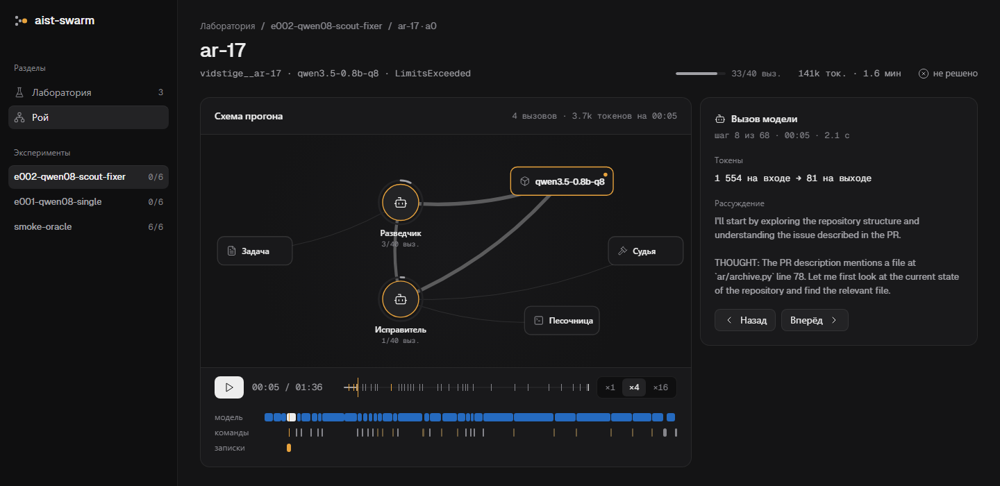
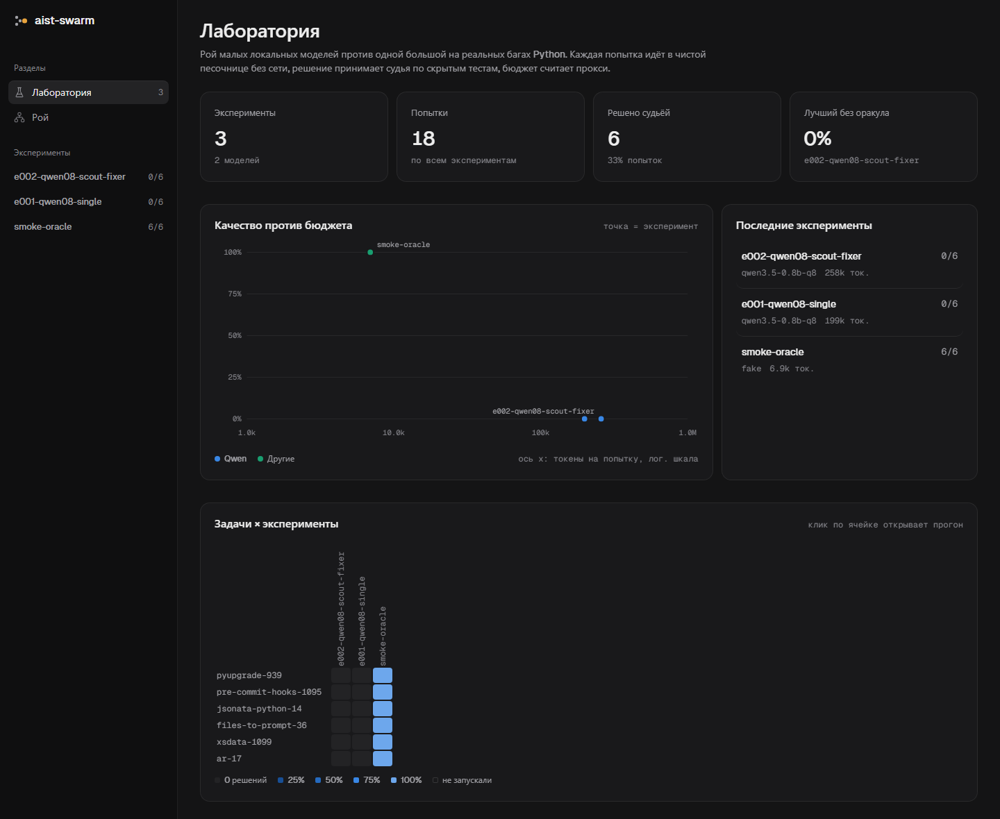

# aist-swarm

Does a swarm of small local models fix more bugs than one larger model on the same GPU, and when? This repo is the
stand that measures it: real Python bugs, hidden tests as the judge, and the same budget for every system.
Research prototype of the AIST lab (ITMO).

## Viewer

Replay of a run: roles, the model and the sandbox as a graph, messages travel along the edges, edges thicken with
the tokens spent, the scout's note to the fixer is the amber dot. Below: timeline lanes and the step on the right.



The lab: quality against budget per experiment, and every task against every experiment.



Each experiment page carries its question, hypothesis and decision rule next to the config ([screenshot](docs/img/experiment.png)).

## How it works

| Module | What it does |
|---|---|
| `tasks` | SWE-bench style tasks: repo at a commit, issue, hidden FAIL_TO_PASS / PASS_TO_PASS tests |
| `sandbox` | Docker: env in a volume, each attempt in a fresh offline container. `AIST_SANDBOX=local`: venvs for hosts without Docker |
| `judge` | Applies the patch and the hidden test patch, runs the deciding tests. Agent-written tests never count |
| `proxy` | Sits in front of any OpenAI-compatible server; meters tokens, calls and time per run and role, enforces budgets |
| `systems` | `miniswe` (mini-SWE-agent baseline), `scout_fixer` (two roles on a FEDOT.Swarm flow) |
| `runner` | Experiment YAML → tasks × attempts → sandbox → system → judge |
| `traces`, `web/` | Normalized run timelines and the viewer |
| `remote` | Packs a job into one Kaggle script and merges its results back |

## Run locally

```bash
uv sync
uv run aist-swarm import tasks.jsonl rebench --env-json env.json   # SWE-bench style rows
uv run aist-swarm build rebench && uv run aist-swarm controls rebench   # gold must pass, empty must fail

llama-server -m Qwen3.5-0.8B-Q8_0.gguf --alias qwen3.5-0.8b-q8 -ngl 99 -c 32768 -np 2 --jinja --port 8080
uv run aist-swarm proxy --upstream http://127.0.0.1:8080/v1
uv run aist-swarm run configs/e001-qwen08-single.yaml

uv run aist-swarm ui                    # API on :8700
cd web && npm install && npm run dev    # viewer on :5173 (?t=<sec> opens a replay paused at that moment)
```

## Run on Kaggle

```bash
uv run aist-swarm kaggle-pack configs/kaggle/k001-size-ladder.yaml   # -> var/kaggle/k001-size-ladder/run.py
kaggle kernels push -p var/kaggle/k001-size-ladder                    # private, GPU, internet on
kaggle kernels output infibiss/aist-swarm-run -p var/kaggle/out
uv run aist-swarm kaggle-merge var/kaggle/out/results.tar.gz
```

The job builds llama.cpp for the GPU it gets, task envs as venvs, pulls models from Hugging Face and runs one model
per GPU behind the proxy.

Docker Hub and deb.debian.org are slow or blocked on some networks; the sandbox image uses `mirror.gcr.io` and
`mirror.yandex.ru` (see `docker/sandbox.Dockerfile`).

## License

MIT, see [LICENSE](LICENSE).
